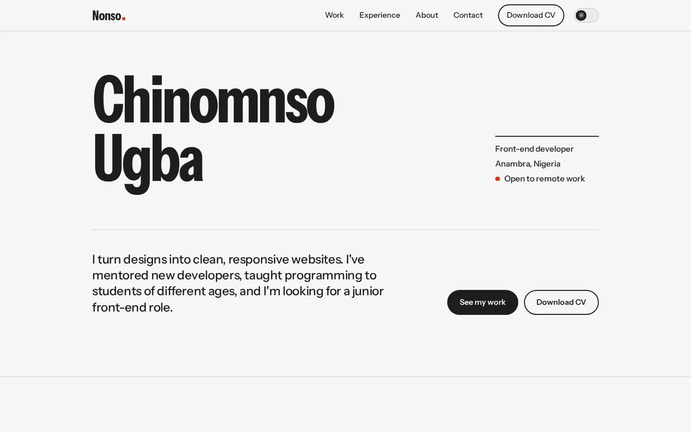
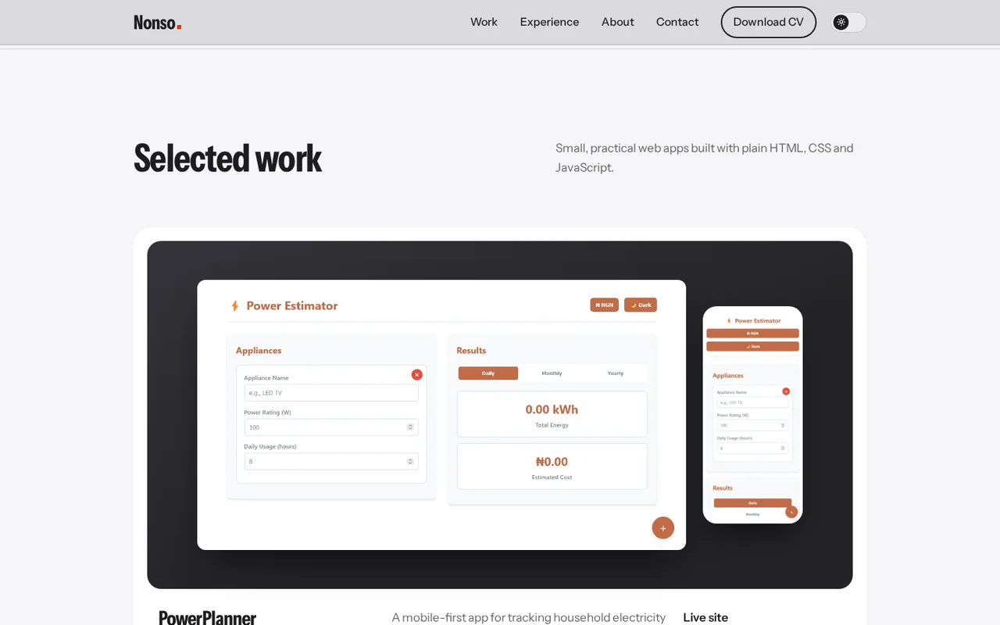
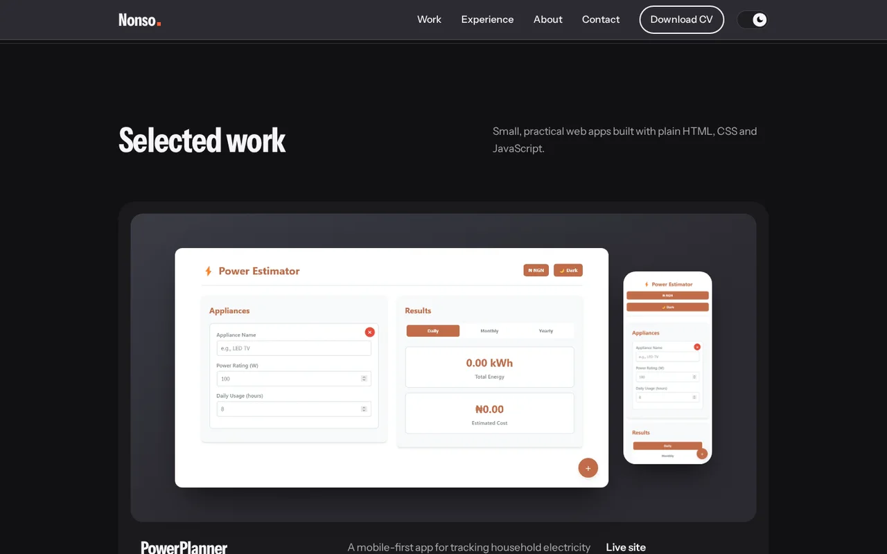
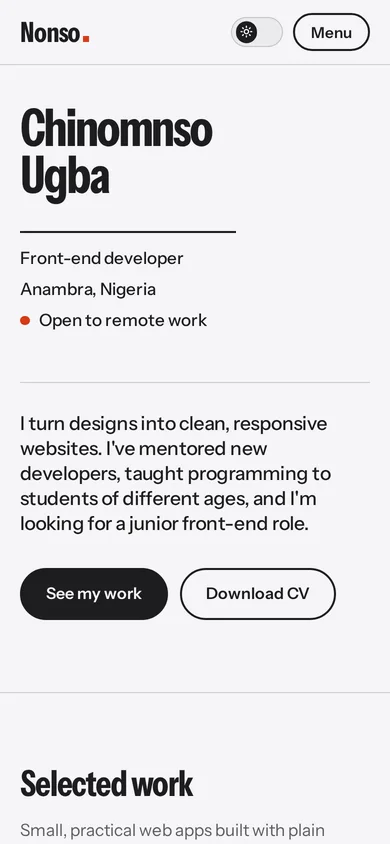
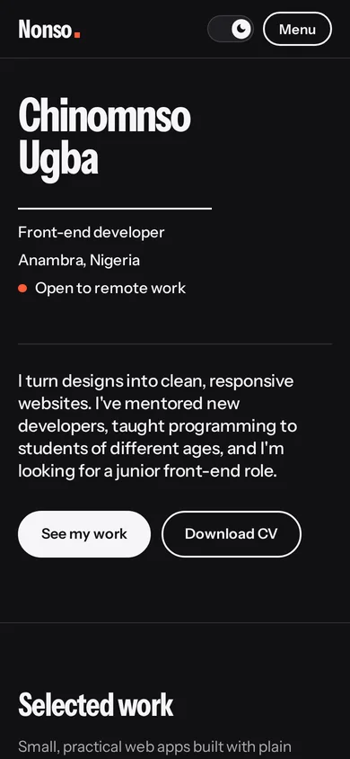

# Chinomnso Ugba | Portfolio

My personal portfolio site: a short introduction, selected projects, my experience and ways to contact me. It is built with plain HTML, CSS and JavaScript, with no frameworks and no build step.

**Live site:** [portfolio-2026-ten-theta-90.vercel.app](https://portfolio-2026-ten-theta-90.vercel.app/)







<p>
  
  
</p>

## What is on the site

- **Home:** my name, role, location and availability, with links to my work and CV.
- **Selected work:** three projects, each with desktop and mobile screenshots, a short description and links to the live site and source code.
- **Experience:** front-end work, mentoring and teaching, newest first.
- **About:** a short introduction, plus what I am comfortable with and still learning.
- **Contact:** email (with a copy button), CV download, and GitHub, LinkedIn and X links.

## Design

- A typographic layout with a soft grey background, rounded cards and a frosted header that turns grey on scroll.
- Project screenshots sit on a dark stage so they stand out from the page.
- Light and dark themes with a switch in the header. It follows the visitor's system setting until they choose, then remembers their choice.
- Three colours only: near-black, off-white and one red-orange accent (a little brighter in dark mode).
- Instrument Sans for text (using its width axis for the large headings) and IBM Plex Mono for small labels.
- Responsive from small phones up to wide desktops, with a menu button on small screens.
- One entrance animation on the name, switched off for visitors who prefer reduced motion.

## Built with

- HTML
- CSS (custom properties, Grid, Flexbox)
- JavaScript (mobile menu, scroll header, theme switch, copy-to-clipboard)
- Google Fonts

## Project structure

```
.
├── index.html
├── css/
│   └── style.css
├── js/
│   └── main.js
├── assets/
│   ├── favicon.svg
│   ├── *.webp          project screenshots (desktop and mobile)
│   ├── portrait.jpg    my photo (to be added)
│   └── Chinomnso-Ugba-CV.pdf
├── screenshots/        images used in this README
├── LICENSE
└── README.md
```

## Run it locally

No install is needed. Open `index.html` in a browser.

To serve it like a real site, run one of these in the project folder and open the address it prints:

```bash
python3 -m http.server 8000
# or
npx serve
```

## Make it your own

- **Photo:** save a portrait (4:5 ratio works best) as `assets/portrait.jpg`. It is shown in black and white.
- **CV:** replace `assets/Chinomnso-Ugba-CV.pdf` with a newer PDF of the same name. The download buttons point to it.
- **Projects:** copy the commented-out template at the bottom of the project list in `index.html`, then add two screenshots to `assets/`.
- **Colours and sizes:** all of them are set once at the top of `css/style.css`, with the dark theme as a second block of the same variables right below.

## Deploy

**GitHub Pages:** go to Settings, then Pages, choose the `main` branch and the root folder, and save.

**Vercel:** import the repository and deploy. No build settings are needed.

## Licence

The code is released under the [MIT License](LICENSE). The text, photos, screenshots and CV are mine and are not covered by that licence. Please do not reuse them.
